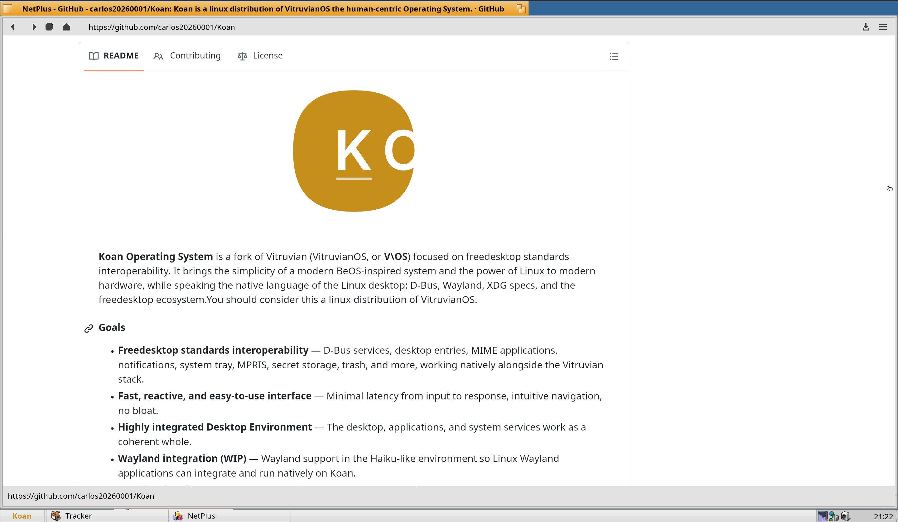
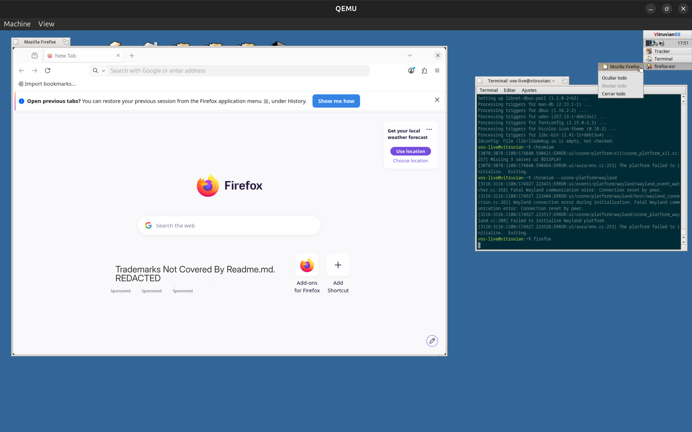
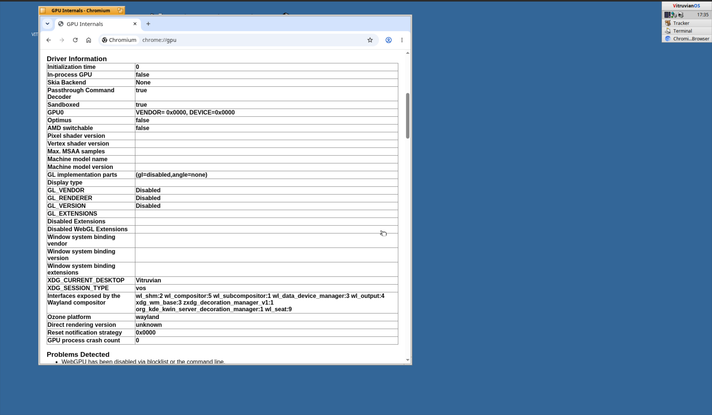
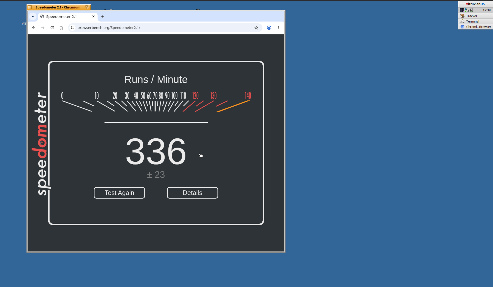

  

**Koan Operating System** is a fork of Vitruvian (VitruvianOS, or **V\OS**) focused on freedesktop standards interoperability. It brings the simplicity of a modern BeOS-inspired system and the power of Linux to modern hardware, while speaking the native language of the Linux desktop: D-Bus, Wayland, XDG specs, and the freedesktop ecosystem.You should consider this a linux distribution of VitruvianOS.

#### Goals

* **Freedesktop standards interoperability** — D-Bus services, desktop entries, MIME applications, notifications, system tray, MPRIS, secret storage, trash, and more, working natively alongside the Vitruvian stack.
* **Fast, reactive, and easy-to-use interface** — Minimal latency from input to response, intuitive navigation, no bloat.
* **Highly integrated Desktop Environment** — The desktop, applications, and system services work as a coherent whole.
* **Wayland integration (WIP)** — Wayland support in the Haiku-like environment so Linux Wayland applications can integrate and run natively on Koan.
* **Fractional scaling (WIP)** — Per-output fractional display scaling for sharp UI on mixed-DPI and high-resolution screens.
* **Modern window decorations (WIP)** - Modern ui for the current and next generations to feel at home.
* **Haiku App Compatibility** - Keep the haiku app compatibility matching at least the VitruvianOS one.
* **Make our own Wordmark** - We don't currently have a Koan svg Wordmark.

---

> **⚠️ Alpha — not ready for production use**
>
> Koan is an **early alpha** operating system. It is **not suitable for production environments**.
> Some debugging and diagnostic options remain enabled even in release ISOs, and it has not
> been security-hardened. **Do not run Koan on untrusted network environments.**

---

### Overview

Koan runs on Linux and takes its look and programming model from BeOS. You get Linux hardware support with a desktop that stays responsive. BeOS/Haiku applications build and run with few or no source changes. On top of that foundation, Koan adds freedesktop standards so Vitruvian applications and services interoperate with the wider Linux desktop.

We ship custom kernel modules and, on amd64, a PREEMPT_RT kernel to keep latency low. The regular kernel works too.

Images boot from ext4, and the live ISO uses SquashFS. XFS and Btrfs also work.

Release images are built for amd64 and arm64, and the arm64 ones include the Raspberry Pi 4 and 5. There's a riscv64 port in the nightly builds. See the [boards site](https://boards.v-os.dev/) (VitruvianOS) for the full list , For Koan itself We only have an amd64 machine so I will only release amd64 in the meanwhile (Check github releases for Koan itself).

### Screen Scaling (HiDPI)

Koan supports fractional per-display scaling so the UI stays sharp on mixed-DPI and high-resolution screens. Scaling is applied
consistently to window bounds, title bars, tabs, controls, fonts, bitmaps,
clipping/damage regions, cursor coordinates, hit tests, resize borders, and
drag-and-drop. Pointer coordinates are transformed in the inverse direction from
rendering so input stays aligned with what you see.

The deskbar and native applications scale automatically with the display. When
moving a window between displays with different scale factors, its logical size
stays stable.

> **⚠️ Browser web content is not scaling-aware**
> >
> > Web content rendered by the browser (e.g. NetPlus) does not automatically
> > respond to system screen scaling. Web pages render and are not
> > resized by the display scale factor. To make web content larger or smaller,
> > use the browser's manual zoom (Ctrl++ / Ctrl− / Ctrl+0) instead.

  

---
### Wip Koan WLROOTS implementation for wayland support
Wayland applications from the Debian repositories run as native Koan windows, with the Koan window frame, Deskbar entries and native window stacking.

What works now:
* Firefox ESR and Chromium (`chromium --ozone-platform=wayland`)
* Mouse and keyboard input
* Menus and popups (GTK/Nautilus menus, browser menus), including keyboard navigation
* Fullscreen (F11 in Firefox, the fullscreen button in Chromium)

> **⚠️ Still WIP**
> >
> > * Screen fractional scaling is not wired up for Wayland yet; Wayland programs were tested at 1.00 scale.
> > * No GPU acceleration yet: Chromium renders in software (`chrome://gpu` reports GL disabled).
> > * Transparent corners of client-drawn windows and menus show black.
> > Upstream .desktop implementation Conflicts with wlroots-koan , so my .desktop implementation still works under installed applications deskbar menu until fix is applied.

  

Chromium on Wayland: `chrome://gpu` shows the Wayland Ozone platform and the interfaces Koan's compositor exposes.

  

Speedometer 2.1 (browserbench.org) in Chromium on Koan's Wayland server: 336 ± 23 runs per minute.

  

### Nexus

Nexus is a set of Linux kernel modules that give Koan its BeOS-style primitives, ports and node monitoring among them. It's a submodule at `src/system/kernel/nexus` and ships as the `nexus-dkms` package. More in the [Nexus repository](https://github.com/VitruvianOS/Nexus) (VitruvianOS).

### Talk to the people who use it

* [Discourse](https://discourse.v-os.dev/), the forum (VitruvianOS)
* [Telegram chat](https://t.me/vitruvian_official_chat), plus a [channel](https://t.me/vitruvian_official) for announcements (VitruvianOS)
* [GitHub issues](https://github.com/VitruvianOS/Vitruvian/issues) for bugs (VitruvianOS)
* The [mailing list](https://www.freelists.org/list/vitruvian), if you like email
* Don't annoy Vitruvian Mantainers with Koan specific bugs

### Installation

Grab an image from Github Releases , write it to a USB stick and boot it. The [installation guide](https://docs.v-os.dev/installation/) (VitruvianOS) has the details. If you'd rather not touch real hardware yet, [run it in a VM](https://docs.v-os.dev/getting-started/virtualization/) (VitruvianOS) .

### Getting started

* [Building from source](https://docs.v-os.dev/getting-started/building/) (VitruvianOS)
* [Coding guidelines](https://docs.v-os.dev/development/coding-guidelines/) (VitruvianOS)
* [Filesystem layout](https://docs.v-os.dev/development/filesystem-layout/) (VitruvianOS)
* [All the docs](https://docs.v-os.dev/) (VitruvianOS)
* [Packages](https://packages.v-os.dev/) (VitruvianOS)

Pull requests are welcome. Have a look at the coding guidelines first.
We will accept AI code contributions in the future as long as they are generated by GPT-6 (Luna,Astra) or Claude Opus 5.5.

## Trademark Notice

Koan Operating System is an independent operating system project derived from VitruvianOS. Koan Operating System is not affiliated with, endorsed by, sponsored by, or officially maintained by the VitruvianOS project or its developers.

VitruvianOS is the name of the upstream project. Its name, branding, and associated marks belong to their respective rights holders.

Debian® is a registered trademark of Software in the Public Interest, Inc. (SPI), managed by the Debian Project.

Linux® is the registered trademark of Linus Torvalds in the United States and other countries.

GPT-6 is a trademark of OpenAI OpCo, LLC.

Claude and Claude Opus are trademarks of Anthropic, PBC.

Mozilla and Firefox are trademarks of the Mozilla Foundation. Other Mozilla product names and marks are trademarks of the Mozilla Foundation or their respective owners.

Koan Operating System is not affiliated with, endorsed by, sponsored by, or officially associated with Mozilla or any of its subsidiaries. References to Mozilla products and technologies are provided solely for identification, compatibility, or descriptive purposes and do not imply any partnership, endorsement, or approval.
Chromium™ is an open-source browser project and a trademark of Google LLC.

Google Chrome™ is a web browser developed and distributed by Google LLC. Chrome and Google Chrome are trademarks of Google LLC.

Koan Operating System is an independent project and is not affiliated with, endorsed by, sponsored by, or officially associated with Google LLC or the Chromium project.

References to Chromium and Google Chrome in this project are made solely for identification, compatibility, and descriptive purposes. Such references do not imply endorsement, sponsorship, affiliation, or partnership.

All Google Chrome and Chromium logos, icons, product branding, and other protected brand assets remain the property of Google LLC. This notice does not grant permission to use Google's trademarks or branding.

The Chromium source code is distributed under its respective open-source licenses. Such licenses do not grant rights to Google's trademarks or proprietary Google Chrome branding.

BrowserBench (browserbench.org) and Speedometer are the names of a browser benchmark website and a browser benchmark maintained by WebKit engine developers under an open governance model. The browserbench.org domain is registered to Apple Inc. (WHOIS registrant organization). These names, and any associated marks, belong to Apple Inc. or their respective owners.

Koan Operating System is not affiliated with, endorsed by, sponsored by, or officially associated with BrowserBench, the Speedometer project, or its maintainers. The Speedometer 2.1 score shown in this README is an informal result from a single run on Koan, provided for descriptive purposes only and it does not imply endorsement, sponsorship, affiliation, or partnership.

All trademarks, product names, logos, and company names are the property of their respective owners. Their use in this project is for identification and attribution purposes only and does not imply endorsement, sponsorship, affiliation, or partnership with Koan Operating System.

### SSH debug boot

Build with `./configure --sshdebug` to include the opt-in SSH debug entry and
the guest-local MCP diagnostics endpoint. The MCP server is reachable through
an SSH local forward; see the [SSH Debug MCP guide](docs/ssh-debug-mcp.md).

### Donate

Koan is built by volunteers. There's is not current dontation page for Koan itself, but you can donate to Vitruvian main project as is the basis for Koan [Donate](https://v-os.dev/donate/) page.

### License

Koan contains components licensed under the [GPL-2.0](LICENSE), [GPL-3.0](https://www.gnu.org/licenses/gpl-3.0.html) (for example the WLCS test modules in `src/add-ons/wlroots-koan/tests/wlcs/`), [MIT](https://opensource.org/licenses/MIT), and [Apache-2.0](data/system/data/licenses/Apache%20v2). Check each component's file and package notices for its applicable license.

Code ported from [air/OS](https://github.com/airos-works/haiku) is under the MIT License; its notice is appended to [LICENSE](LICENSE), and every ported file keeps its original copyright header and every ported commit its original author.
